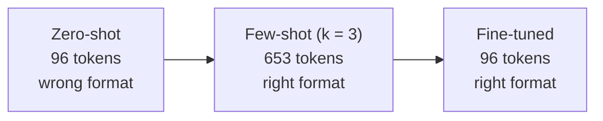
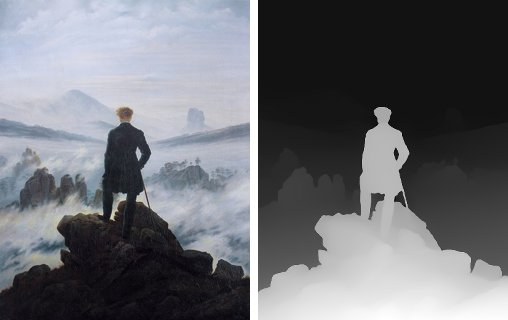
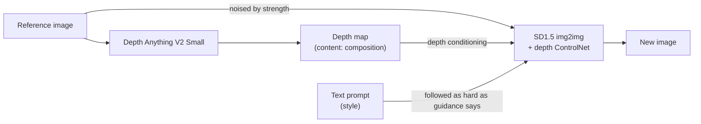
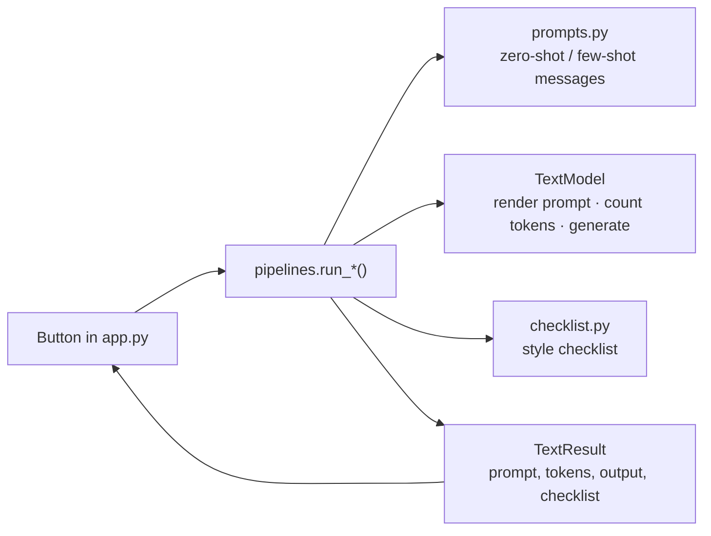

# How Style Transfer Works: a Beginner's Guide

This guide explains **style transfer** from the ground up and walks through every tab of the Style Transfer Explorer app. No machine-learning background is needed. If a word is unfamiliar, check the [glossary](../GLOSSARY.md); the words in **bold** below are defined there.

> **The 30-second version.** Style transfer rewrites an input so that its **content** is kept and its **style** changes. For text there are three ways to tell a model what style you want: describe it (**zero-shot**), show it a few **example pairs** in the prompt (**few-shot**), or fine-tune it on many examples (**fine-tuning**). Describing is cheap but vague; showing works better but every example costs prompt tokens on every call; fine-tuning costs effort once, then gets the style from a short prompt. For images, a **depth map** carries the **reference image**'s composition (its content) while a text prompt sets the new look (its style).

All the examples below are real outputs from the app: Qwen2.5-0.5B-Instruct on CPU, temperature 0 (greedy, so you get the same output when you click), and the committed **adapter** in `adapters/qwen2.5-0.5b-email/`.

---

## 1. Content and style

Every style transfer splits the input into two parts:

| | **Content** (must be kept) | **Style** (allowed to change) |
|---|---|---|
| Notes → professional email | The facts: who, what, when, each point in the notes | Format (`Subject:`, `Body:`, greeting, sign-off), tone, wording |
| Plain sentence → social media | What happened ("the sunset was beautiful") | Emoji, hashtags, slang, capital letters |
| Painting → new image | The composition: what is near, what is far, where the figures stand | Subject matter, colours, medium (oil, woodblock print, neon photo) |

A good style transfer changes the style **without** losing the content. Both failures happen in practice: an email that sounds right but drops half the points, or an image in the right style whose figure has wandered off.

### How the app tells whether it worked: the style checklist

Judging "is this the right style?" by eye is unreliable, so every text output gets a **style checklist**: simple rule-based checks, each reported as pass/fail with its evidence. It's not a quality score, just evidence you can verify.

- **Professional email** (the dataset's format): has a `Subject:` line; has a `Body:` section; opens with a greeting (and says whether it uses `{name}`); ends with a sign-off followed by `{name}`; and **content kept**: does every point (bullet) from the notes appear in the email?
- **Social media**: counts emoji and hashtags.

Every one of the dataset's 200 example emails has the same shape: `Subject: …`, a blank line, `Body: Hello {name},` (or *Hi*, *Dear*), the points from the notes as `- ` bullets copied word for word, and `Best regards,` / `{name}` at the end. The `{name}`, `{date}` etc. are placeholders that are meant to stay as written. That strict format makes the style easy to check, and, as you'll see, easy for a model to learn.

---

## 2. Zero-shot: describe the style (tab ①)

### The idea

Put a description of the style in the instructions (the *system prompt*) and the input in the user message. No examples. The app sends this as a chat, and the model's *chat template* turns it into the exact text the model reads. The app shows that rendered prompt and counts its tokens (a token is a chunk of text, roughly ¾ of a word; prompt tokens are what you pay for with a hosted model).

### A real example from the app

The Professional email preset with notebook 0's notes. This is the complete rendered prompt, **68 tokens**:

```
<|im_start|>system
You are a helpful assistant converting notes to professional emails.<|im_end|>
<|im_start|>user
urgent: need meeting minutes by {deadline}
for stakeholder presentation
details:
- This is needed for our upcoming presi to stakeholders.
- will need ur help asap
- send 2 me when rdy<|im_end|>
<|im_start|>assistant
```

The output starts like this (shortened; the full reply is about 30 lines):

```
Subject: Urgent: Meeting Minutes Needed by [Deadline]

Dear [Recipient's Name],

I hope this message finds you well.

I am writing to request the following:

1. **Meeting Minutes**: Please provide the meeting minutes from today, ...
2. **Stakeholder Presentation Preparation**: ...
3. **Follow-Up**: ...
4. **Timeframe**: We have an important meeting scheduled with stakeholders tomorrow. ...
...
Best regards,

[Your Full Name]
[Your Position]
[Your Contact Information]
[Your Company/Institution]
```

Its style checklist:

| Check | Result | Evidence |
|---|---|---|
| Has `Subject:` line | ✅ | `Subject: Urgent: Meeting Minutes Needed by [Deadline]` |
| Has `Body:` section | ❌ | No line starts with `Body:` |
| Greeting | ✅ | `Dear [Recipient's Name],` (does not use `{name}`) |
| Sign-off with `{name}` | ❌ | Ends with `[Your Contact Information] / [Your Company/Institution]` |
| Content kept | ❌ | 0/3 points kept |

It reads like *an* email, but not like *this dataset's* email: no `Body:`, invented placeholders (`[Deadline]` instead of `{deadline}`), an invented "meeting tomorrow", and none of the three points copied over. The instructions said "professional email"; they didn't say *which* format, and a one-line description can't carry all of that. (OpenAI's `gpt-3.5-turbo` in notebook 0 makes the same kind of miss: no `Body:`, no `{name}`.)

On a looser style, zero-shot does better. Social media preset, input "The sunset was beautiful this evening." (**30 tokens**):

```
✨ Sunset this evening! 🌅✨
```

3 emoji ✅, 0 hashtags ❌.

---

## 3. Few-shot: show the style (tab ②)

### The idea

Keep the zero-shot prompt and put **example pairs** in front of the input: each pair is a past input and its correct output. The app adds each pair as a user turn (the input) followed by an assistant turn (the output), as if the model had already answered those requests correctly. With k = 0 pairs, the prompt is exactly the zero-shot prompt.

Email example pairs always come from the dataset's 180 training pairs, in a fixed order; the 20 **test pairs** are never put in a prompt. Social media uses notebook 1's four pairs.

### What it costs

Every example pair is sent again on every call. Prompt tokens for the email preset's default input, as k grows:

| k (example pairs) | 0 | 1 | 2 | 3 | 4 | 5 | 6 | 7 | 8 |
|---|---|---|---|---|---|---|---|---|---|
| Prompt tokens | 68 | 221 | 426 | 625 | 834 | 1025 | 1221 | 1343 | 1537 |

Each email pair adds roughly 150 to 200 tokens, so k = 8 makes the prompt about **23 times** as long as zero-shot. Social media pairs are short: 30, 65, 106, 151, 196 tokens for k = 0 to 4.

### A real example from the app

Social media with all k = 4 notebook pairs (196 tokens), same input:

```
Absolutely stunning tonight's sunset! 🌅 It's like a masterpiece in motion! #sunsetlove #naturewatching
```

1 emoji ✅, **2 hashtags ✅**: three of the four examples end with hashtags, and the model picked that up.

Examples only help when they look like the input, though. With the email preset at k = 3 (625 tokens), notebook 0's *request*-style notes still get a generic email (no `Body:`, `[Your Full Name]` at the end, 0/3 points kept), because the first three training pairs are a feedback note and two meeting summaries, not requests. Few-shot shows the model a pattern; if the pattern doesn't match the input, it's less useful. Section 5 shows few-shot working on a meeting note.

Try editing an example pair in the app (they are editable expanders) to see what wrong or inconsistent examples do.

---

## 4. Fine-tuning: build the style into the weights (tab ③)

### The idea

Instead of showing examples on every call, show them **once, during fine-tuning**, and change the model's weights so it produces the style by itself. Afterwards the prompt is as short as zero-shot.

Fine-tuning a whole model is expensive, so the app uses **LoRA**: the **base model**'s weights are frozen, and a small set of extra weights, the **adapter**, is trained and added on top. Here the adapter is about 4 MB, next to the base model's ~1 GB. An adapter only works with the base model it was fine-tuned from, which is why tab ③ always uses the 0.5B model.

### What fine-tuning did

`scripts/train_adapter.py` fine-tuned the adapter on the 180 training pairs, each sent as the short zero-shot prompt (system prompt + notes) followed by the expected email, with the loss computed only on the email. Settings, from `adapters/qwen2.5-0.5b-email/loss_history.json`: 3 epochs, 135 optimizer steps (effective batch 4), LoRA rank 8 on the attention projections (`q_proj`, `k_proj`, `v_proj`, `o_proj`), learning rate 2e-4, about 80 minutes on an M2 CPU.

The **training loss** measures how surprised the model is by the expected emails' next tokens; lower means it predicts them better.

| | Loss |
|---|---|
| Step 1 | 1.466 |
| Epoch 1 average | 0.421 (last step 0.019) |
| Epoch 2 average | 0.004 |
| Epoch 3 average | 0.002 |
| Final step (135) | 0.0012 |

The loss collapses within the first epoch because the dataset's emails follow a handful of strict templates; once the model has learned them, there is little left to be surprised by. The tab shows this curve, and a slider to browse the training pairs.

### A real example from the app

Notebook 2's free-text test, "schedule a meeting with John about the Q4 planning". Both models get the same **34-token** prompt.

Base model (shortened):

```
Subject: Meeting Request for Q4 Planning

Dear [John's Name],

I hope this message finds you well.

I am writing to request an appointment to discuss the Q4 planning process. ...
1. Budgeting and resource allocation
2. Sales performance metrics
...
Best regards,

[Your Full Name]
[Your Position]
[Your Contact Information]
```

Base model + adapter (complete):

```
Subject: Request for meeting with John

Body: Hello John,

I hope you're doing well. I'm reaching out because I need to schedule a meeting with you about the Q4 planning.

Could you please help me with this? Let me know if you need any additional information.

Thank you in advance for your help.

Best,
John
```

The adapter brought in the dataset's format (`Body:`, `Hello …,`, `Best,` with a short request-style body) and stopped the base model from inventing an agenda. It's not perfect: it signs off as "John" instead of `{name}`, so that check fails. The free text has no bullet points, so its content-kept check (which looks for the whole sentence verbatim) also fails for both.

---

## 5. The three techniques side by side

### A real example from the app

The *Compare all three techniques* panel in tab ③ runs zero-shot, few-shot (k = 3) and fine-tuned on the same input. Here it is on **test pair 1**, which neither the adapter nor the few-shot prompt has seen:

```
mtg w/ Design team @ {location} - {date} {time}
disscussed budget review
key points:
- Aligned on priorities for the next quarter
- Identified resource needs and constraints
- Updated timeline and deliverables
next:
- Create action items list
- Schedule follow-up meeting next week
pls respond w/ questions
```

| | Zero-shot | Few-shot (k = 3) | Fine-tuned |
|---|---|---|---|
| Model | base | base | base + adapter |
| Prompt tokens | **96** | **653** | **96** |
| Has `Subject:` line | ✅ | ✅ | ✅ |
| Has `Body:` section | ❌ | ✅ | ✅ |
| Greeting | ✅ `Dear [Recipient's Name],` | ✅ `Body: Dear Design team,` | ✅ `Body: Dear Design team,` |
| Sign-off with `{name}` | ❌ | ✅ | ✅ |
| Content kept | ❌ 0/5 (points reworded as a numbered list) | ✅ 5/5 | ✅ 5/5 |

Few-shot and fine-tuned produced the same email:

```
Subject: Design Team Meeting Summary - {date}

Body: Dear Design team,

I hope this email finds you well. I'm writing to summarize our team meeting that took place on {date} at {time} in {location}.

During our discussion about budget review, we covered several key points:
- Aligned on priorities for the next quarter
- Identified resource needs and constraints
- Updated timeline and deliverables

Next steps:
- Create action items list
- Schedule follow-up meeting next week

Please let me know if you have any questions or if I missed anything important.

Best regards,
{name}
```

It matches the test pair's expected email word for word. That is not leakage: the test pair's notes appear nowhere in fine-tuning, but the dataset writes every meeting summary with the same template, and the second few-shot example pair (an Engineering team meeting) uses that template too. Here few-shot copies the template from the prompt; the fine-tuned model has learned it into its weights.

This is the chapter's main lesson, in one row of the table:



| | Zero-shot | Few-shot | Fine-tuning |
|---|---|---|---|
| Effort up front | none | pick good example pairs | collect many pairs, fine-tune (here ~80 min CPU) |
| Prompt cost per call | low | high, grows with k | low |
| Style quality | only what a description can say | good when examples match the input | good on the style it was fine-tuned on |
| Flexibility | change the instructions any time | change the examples any time | fine-tune again to change the style |

---

## 6. Image style transfer: depth conditioning (tab ④)

### The idea

For an image, the **content** is its composition and the **style** is everything else. The app keeps the composition with a **depth map**: a grayscale picture in which each pixel's brightness says how near that point is (brighter = nearer). Depth Anything V2 Small computes it from the **reference image**. These are real depth maps from the app's depth module (shown at 320 px):




The depth map has no colour, brushwork or subject matter, only shapes and distances: the wanderer's outline and the rock under him in front of a dark, distant sea of fog; the couple, the lamp post and the umbrellas in front of a street that fades into the distance. That's exactly the part a style transfer should keep.

Generation then runs Stable Diffusion 1.5 *img2img* with a depth ControlNet. **Depth conditioning** means the depth map steers every denoising step, so whatever the prompt asks for ("Darth Vader with a red light saber", "a neon-lit cyberpunk city street") is drawn into the reference image's layout.



### Strength and guidance

Two numbers control the result:

- **Strength** (0 to 1): how far generation may move away from the reference image's pixels. img2img adds noise to the reference image and then removes it again; strength is how much noise. At 0.3 the colours and brushwork of the painting survive; at 0.9 almost nothing of the pixels does, and the composition comes mostly from the depth map.
- **Guidance**: how closely generation follows the text prompt. Low values (3) drift more freely and look softer; high values (12) follow the prompt harder, often with harsher, oversaturated colours.

Generating one image takes many minutes on a laptop CPU, so the app shows a precomputed grid instead ([ADR 0002](adr/0002-precomputed-image-grid-instead-of-live-generation.md)): for each reference image and prompt, every strength (0.3 / 0.5 / 0.7 / 0.9) × guidance (3 / 7.5 / 12), plus the same prompt at strength 0.7 / guidance 7.5 **without** depth conditioning. That last pair shows what the depth map adds: without it, only the noised pixels hold the composition, so at high strength the figures, horizon and perspective drift.

The grid is rendered on a Colab GPU by `scripts/render_grid.py`. Until it is committed to `data/grid/`, tab ④ shows placeholders for the generated images (the depth maps work regardless), so this guide doesn't show generated images yet.

---

## 7. How the app is built



Every text tab calls one pipeline function, and every pipeline returns the same `TextResult`, so any technique can be shown, or compared, the same way. The pipelines receive the model as an argument; the tests pass in a fake model, so they can check which example pairs went into a prompt and that k = 0 equals zero-shot without downloading anything. Example pairs for email come only from `dataset.py`'s fixed 180/20 split. The image tab looks images up in the grid manifest by their parameters (`image_grid.py`). See the [README](../README.md#project-structure) for the file list.

---

## 8. Where the app differs from the notebooks

| Notebook | App | Why |
|---|---|---|
| OpenAI `gpt-3.5-turbo` | Local Qwen2.5 0.5B (1.5B optional) | Free, and the exact prompt and token count are visible ([ADR 0001](adr/0001-local-qwen-instead-of-openai.md)). Writing is weaker. |
| Temperature 0.7 / API default | Temperature 0 by default (slider) | Reproducible outputs, so techniques can be compared fairly. |
| Notebook 1: instructions and `Input:` / `Output:` lines in one user message | Instructions as the system message; each example pair as a user turn + assistant turn | The same shape for every preset, and k = 0 is exactly the zero-shot prompt. |
| Notebook 2: OpenAI fine-tuning job | A LoRA adapter fine-tuned locally on CPU and committed | No account or cost; fine-tuning settings and loss curve are visible. |
| Notebook 2: tests on a training example (and says it's bad practice) | 20 held-out test pairs, never in fine-tuning or few-shot prompts | A fair comparison. The dataset repeats some notes, so test pairs are chosen only from notes that appear once (see the [README](../README.md#the-dataset-and-its-split)). |
| Notebook 3: DPT-Large depth (pipeline default) | Depth Anything V2 Small | Small enough to run live on a laptop CPU. |
| Notebook 3: one live image, 100 steps, no seed | Precomputed grid, 50 steps, fixed seed; live generation only on a CUDA GPU | An 8 GB laptop can't run SD1.5 usefully; a grid shows each parameter's effect side by side ([ADR 0002](adr/0002-precomputed-image-grid-instead-of-live-generation.md)). |
